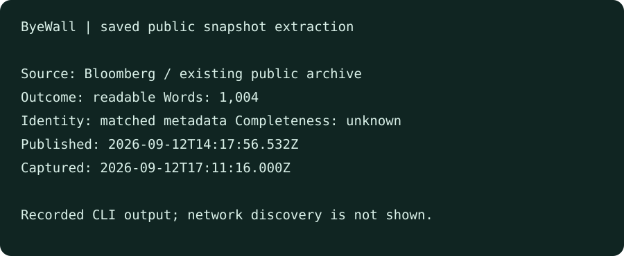

# Recorded CLI example

This recording runs the packaged CLI against a previously saved **public Bloomberg snapshot**, whose visible source was reviewed in Safari during development. It demonstrates local extraction and provenance, not a fresh archive lookup. Article text and request details are omitted from the displayed output. The saved article itself is not distributed.

- [Original publisher article](https://www.bloomberg.com/news/articles/2026-09-12/anthropic-ceo-says-it-s-time-to-slow-pace-of-improving-ai-models)
- [Existing public snapshot](https://archive.is/20260912171116/https://www.bloomberg.com/news/articles/2026-09-12/anthropic-ceo-says-it-s-time-to-slow-pace-of-improving-ai-models)
- [Recorded metadata](result.json)
- [Terminal recording](demo.cast), playable with `asciinema play demo/demo.cast`

The result was 1,004 extracted words with matching archive identity. Publication and capture dates remain separate. Automated completeness remains unknown; matching metadata alone is not independent source verification. Archive access can differ on subsequent requests.
